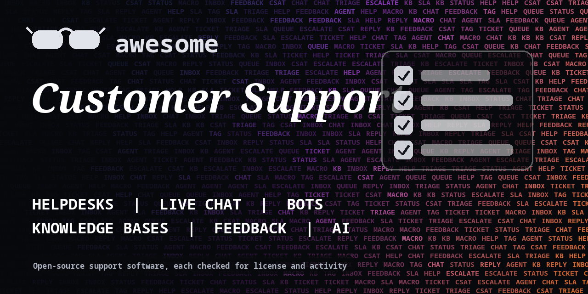

<h1 align="center">Awesome Customer Support</h1>

> Open-source helpdesks, live chat, chatbots, knowledge bases and feedback tools for support teams. Every entry shows its license.

**Rules of this list:** every repo exists, is public, is not archived, states a license and has had a commit in the last year. One plain sentence each. Star counts and claims are the authors' own, we did not test every tool. Checked 2026-10-18. See [CONTRIBUTING.md](CONTRIBUTING.md).

## Contents

- [Helpdesk and ticketing](#helpdesk-and-ticketing)
- [Live chat and messaging](#live-chat-and-messaging)
- [Chatbots and AI support agents](#chatbots-and-ai-support-agents)
- [Knowledge bases and docs](#knowledge-bases-and-docs)
- [Feedback and surveys](#feedback-and-surveys)
- [Status pages and uptime](#status-pages-and-uptime)
- [Call center and voice](#call-center-and-voice)
- [How to choose](#how-to-choose)
- [Contributing](#contributing)

## Helpdesk and ticketing

Shared inboxes and ticket queues.

- [chatwoot/chatwoot](https://github.com/chatwoot/chatwoot)  - Open-source customer messaging platform and shared inbox. _(check repo)_
- [frappe/helpdesk](https://github.com/frappe/helpdesk)  - Open-source helpdesk built on the Frappe framework. _(AGPL-3.0)_
- [freescout-help-desk/freescout](https://github.com/freescout-help-desk/freescout)  - Free self-hosted help desk and shared mailbox. _(AGPL-3.0)_
- [glpi-project/glpi](https://github.com/glpi-project/glpi)  - IT service management and asset tracking with ticketing. _(GPL-3.0)_
- [osTicket/osTicket](https://github.com/osTicket/osTicket)  - Widely used open-source support ticket system. _(GPL-2.0)_
- [zammad/zammad](https://github.com/zammad/zammad)  - Web-based open-source helpdesk and customer support system. _(AGPL-3.0)_

## Live chat and messaging

Chat widgets and omnichannel inboxes.

- [crisp-im/crisp-sdk-web](https://github.com/crisp-im/crisp-sdk-web)  - SDK for the Crisp chat widget. The service behind it is paid. _(MIT)_
- [RocketChat/Rocket.Chat](https://github.com/RocketChat/Rocket.Chat)  - Open-source team chat with omnichannel customer support. _(check repo)_

## Chatbots and AI support agents

Answer common questions. Hand off to a person when needed.

- [botpress/botpress](https://github.com/botpress/botpress)  - Open-source platform for building conversational AI agents. _(MIT)_
- [deepset-ai/haystack](https://github.com/deepset-ai/haystack)  - Framework for building search and RAG applications. _(Apache-2.0)_
- [infiniflow/ragflow](https://github.com/infiniflow/ragflow)  - RAG engine focused on deep document understanding. _(Apache-2.0)_
- [langgenius/dify](https://github.com/langgenius/dify)  - Platform for building LLM apps with workflows and RAG. _(check repo)_
- [Mintplex-Labs/anything-llm](https://github.com/Mintplex-Labs/anything-llm)  - All-in-one app to chat with documents using any model. _(MIT)_
- [onyx-dot-app/onyx](https://github.com/onyx-dot-app/onyx)  - Open-source AI search and chat over your team's documents. _(check repo)_
- [onyx-dot-app/onyx](https://github.com/onyx-dot-app/onyx)  - Open-source AI platform with search and chat over company knowledge. _(check repo)_
- [open-webui/open-webui](https://github.com/open-webui/open-webui)  - Self-hosted web interface for local and hosted language models. _(check repo)_
- [RasaHQ/rasa](https://github.com/RasaHQ/rasa)  - Framework for building contextual AI assistants and chatbots. _(Apache-2.0)_

## Knowledge bases and docs

Self-serve help centers.

- [BookStackApp/BookStack](https://github.com/BookStackApp/BookStack)  - Simple, self-hosted wiki platform for organizing documentation. _(MIT)_
- [facebook/docusaurus](https://github.com/facebook/docusaurus)  - Build optimized documentation websites with React. _(MIT)_
- [fuma-nama/fumadocs](https://github.com/fuma-nama/fumadocs)  - React framework for building documentation sites. _(MIT)_
- [mintlify/starter](https://github.com/mintlify/starter)  - Starter kit for Mintlify docs. The hosting is a paid service. _(MIT)_
- [outline/outline](https://github.com/outline/outline)  - Fast, collaborative team knowledge base. _(check repo)_
- [requarks/wiki](https://github.com/requarks/wiki)  - Modern wiki app built on Node.js. _(AGPL-3.0)_
- [squidfunk/mkdocs-material](https://github.com/squidfunk/mkdocs-material)  - Documentation framework on top of MkDocs. _(MIT)_
- [vuejs/vitepress](https://github.com/vuejs/vitepress)  - Static site generator for documentation, built on Vite and Vue. _(MIT)_

## Feedback and surveys

Collect feature requests and ratings.

- [formbricks/formbricks](https://github.com/formbricks/formbricks)  - Open-source survey and experience management platform. _(check repo)_
- [getfider/fider](https://github.com/getfider/fider)  - Open-source feedback board for collecting and prioritizing ideas. _(AGPL-3.0)_
- [heyform/heyform](https://github.com/heyform/heyform)  - Open-source form builder for surveys and quizzes. _(AGPL-3.0)_
- [LimeSurvey/LimeSurvey](https://github.com/LimeSurvey/LimeSurvey)  - Open-source survey tool. _(check repo)_
- [usertour/usertour](https://github.com/usertour/usertour)  - Open-source user onboarding and product tours. _(check repo)_

## Status pages and uptime

Tell customers when something breaks.

- [cstate/cstate](https://github.com/cstate/cstate)  - Static status page generator built on Hugo. _(MIT)_
- [louislam/uptime-kuma](https://github.com/louislam/uptime-kuma)  - Self-hosted uptime monitoring tool. _(MIT)_
- [OneUptime/oneuptime](https://github.com/OneUptime/oneuptime)  - Open-source observability, status pages and incident management. _(check repo)_
- [TwiN/gatus](https://github.com/TwiN/gatus)  - Developer-oriented health dashboard and status page. _(Apache-2.0)_
- [upptime/upptime](https://github.com/upptime/upptime)  - Uptime monitor and status page powered by GitHub Actions. _(MIT)_

## Call center and voice

Phone support and voice bots.

- [asterisk/asterisk](https://github.com/asterisk/asterisk)  - Open-source PBX and telephony toolkit. _(check repo)_
- [fonoster/fonoster](https://github.com/fonoster/fonoster)  - Open-source programmable telecom and voice AI platform. _(MIT)_
- [livekit/agents](https://github.com/livekit/agents)  - Framework for building real-time voice AI agents. _(Apache-2.0)_
- [pipecat-ai/pipecat](https://github.com/pipecat-ai/pipecat)  - Framework for real-time voice and multimodal conversational agents. _(BSD-2-Clause)_
- [signalwire/freeswitch](https://github.com/signalwire/freeswitch)  - FreeSWITCH telephony platform maintained by SignalWire. _(check repo)_

## How to choose

- **Keep a human path.** Every bot should hand off to a person.
- **Check data location** if you store customer messages.
- **Track a few numbers:** first reply time, resolution time, satisfaction.
- **Check the license** and who owns the hosted version.

## Contributing

See [CONTRIBUTING.md](CONTRIBUTING.md). One entry per pull request, plain words, real sources only.

## About

Maintained by [@devanasolver](https://github.com/devanasolver). Listings follow the rules in CONTRIBUTING.

## Sponsor me

If this list is useful, [buy me a coffee](https://buymeacoffee.com/isaac49).
